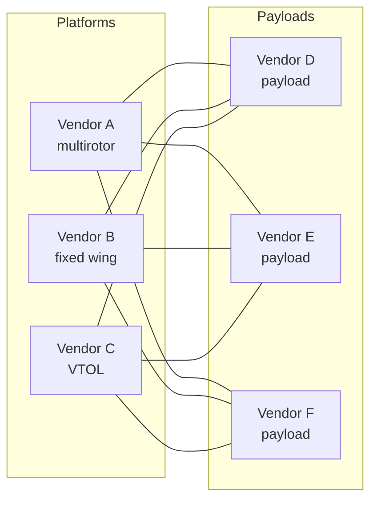
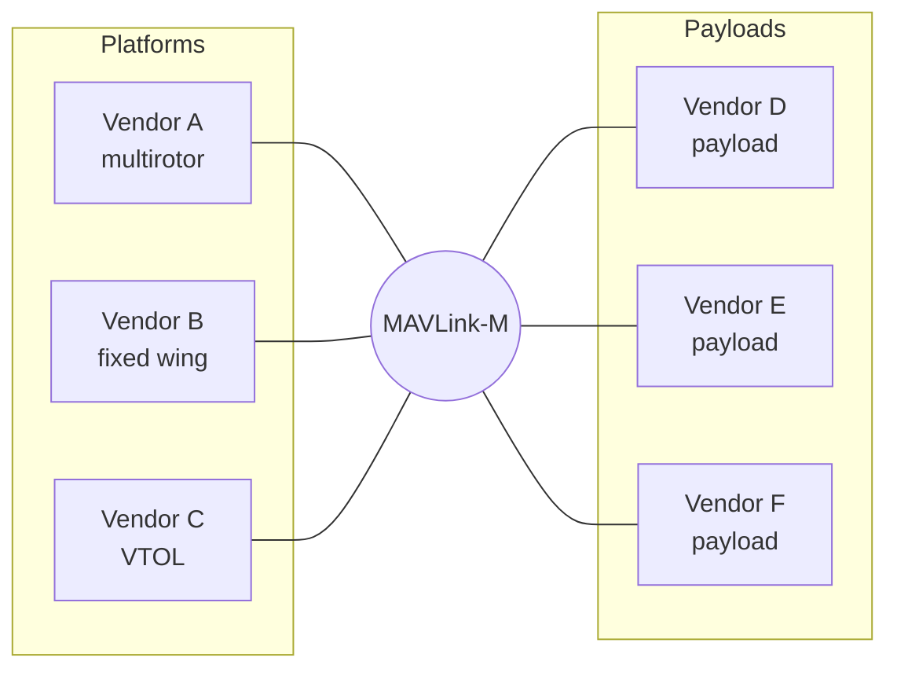

# Why MAVLink-M

MAVLink-M is one open interface for military payloads and platforms. It is a
dialect of [MAVLink 2](https://mavlink.io), the protocol PX4 and QGroundControl
already speak, and it adds a public message set for safety and arming,
targeting and engagement, remote weapon systems, and shared tracks. It is MIT
licensed and hosted by the [Dronecode Foundation](https://dronecode.org), so
any vendor or nation can adopt it without negotiating terms.

## The problem

Every pairing of a platform and a payload is its own integration project. Three
platforms and three payloads take nine integrations, and each one rebuilds
arming, ignition and fault logic for that pair. The requirements are
converging, but vendors fill the gaps with private MAVLink extensions that
drift apart, or bypass MAVLink altogether.

That duplicated work doesn't scale, and interoperability is becoming a
procurement requirement, not a nice-to-have.

## One interface instead

With one shared interface, each platform and each payload implements it once:
six implementations instead of nine. A new payload works with every platform
that already speaks MAVLink-M, and the saving grows with the fleet: ten
platforms and ten payloads take 20 implementations instead of 100 integrations.

## Why a dialect, not a fork

A MAVLink dialect is an XML message set layered on the core messages.
`military.xml` includes `common.xml` and adds its own messages in the
`53000-53999` range, so it changes no core message and collides with no other
dialect.

- Systems that don't speak MAVLink-M ignore its messages and keep working with
  each other on the core set.
- Every improvement to core MAVLink carries over, with nothing to merge.
- The model is proven: dialects have extended MAVLink for over a decade, and
  vendors ship them for gimbals, ADS-B and companion devices.

Forks diverge. Dialects ride along.

## Why open

| Today | With MAVLink-M |
| --- | --- |
| A custom integration for every platform and payload pair | One shared interface |
| Locked into one vendor's stack | Components you can swap |
| Black-box interfaces | Every message and field publicly defined |
| Private forks that drift | One upstream standard everyone builds on |

The dialect is MIT licensed, so any vendor, program or nation can use it
without a license negotiation. It is developed in the open by a working group
hosted by the Dronecode Foundation, the Linux Foundation project that is also
home to PX4, MAVLink and QGroundControl.

## Get involved

MAVLink-M is a public draft, and feedback closes when the standard freezes in
November 2026. Join the working group on the
[MAVLink-M mailing list](https://lists.dronecode.org/g/mavlink-m), or open an
issue or a pull request on
[GitHub](https://github.com/Dronecode/mavlink-military). See
[Contributing](../contributing.md) for how changes are proposed and reviewed.
