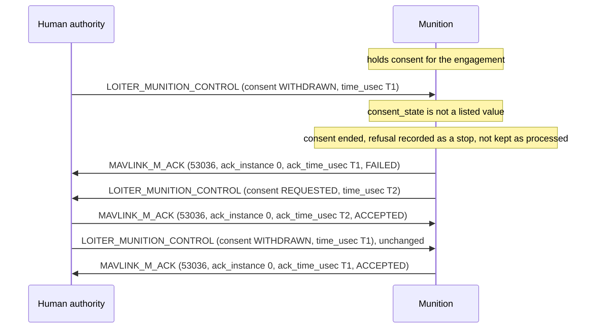
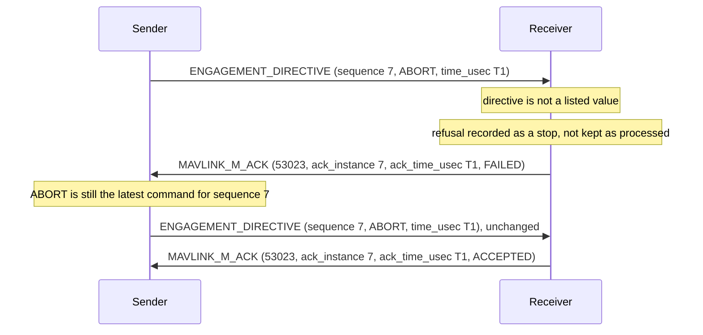

# Refusals and Resends

## Introduction

This page covers what follows when a receiver refuses a message because a commanded field is not one of its enum's listed values, as [Commanded Values](status_field_encoding.md#commanded-values) sets out: what the receiver records, what the sender sends again, and how consent and clearance are shown after a refusal or a restart.
The acknowledgment rules it builds on, keys, duplicates and the duplicate window, are in the [MAVLINK_M_ACK](../messages/military.md#MAVLINK_M_ACK) description.

## What a Refusal Records

Besides what [Commanded Values](status_field_encoding.md#commanded-values) lists, a receiver that refuses a message:

- unless it is an [ESAD_CONFIG](../messages/military.md#ESAD_CONFIG), a [CALL_FOR_FIRE](../messages/military.md#CALL_FOR_FIRE) or a [CAS_9LINE](../messages/military.md#CAS_9LINE), which carry no stop, records the refusal as a stop covering everything, as SAFETY BOUNDARIES in the `military.xml` header says, since the value it could not read may have been a stop: a start issued before the refused message arrived is then held, an unchanged copy of a refused start included, while what is already running goes on
- if it is a munition refusing a [LOITER_MUNITION_CONTROL](../messages/military.md#LOITER_MUNITION_CONTROL), ends any consent-to-strike it holds and asks for it again, and if it is an aircraft refusing a [TERMINAL_CONTROL](../messages/military.md#TERMINAL_CONTROL), treats any clearance it holds as withdrawn, as those messages' descriptions set out

The refusal is not final: the receiver does not keep the refused message as processed under the duplicate rule in the [MAVLINK_M_ACK](../messages/military.md#MAVLINK_M_ACK) description, so a later copy of it is checked again, and an answer to that copy other than `MAVLINK_M_ACK_FAILED` replaces the `MAVLINK_M_ACK_FAILED`.
Once a component has accepted a copy, a `MAVLINK_M_ACK_FAILED` from it for another copy does not mean that it did not apply the message, though what the refusal itself does, the stop record and an ended consent or clearance, still stands.
[Resending a Refused Command](#resending-a-refused-command) says what the sender sends.

A copy that differs from a message the receiver has processed only in commanded fields whose values are not listed is not refused, since the sender gives each message its own `time_usec` (see [Resending a Refused Command](#resending-a-refused-command)) and the difference can only be damage.
The receiver acts on nothing in it, records nothing for it and does not answer it, so its answer to that message stands, and a copy the sender sends for want of an answer is checked again.

A message sent with `target_system` 0 that, as the receiver reads it, carries no stop is not acted on or kept as processed, so the sender's repeats of a stop still reach a receiver whose copy was damaged.

A bridge or gateway handles a refused message and its copies as [Bridges and Gateways](status_field_encoding.md#bridges-and-gateways) says.

## Resending a Refused Command

A sender gives each message with a commanded field a `time_usec` later than that of the previous message with the same message ID it sent, so no two of its messages are answered with the same `ack_msgid`, `ack_instance` and `ack_time_usec`.
A [SPLASH_CORRECTION](../messages/military.md#SPLASH_CORRECTION), whose `time_usec` is the time of its observation, takes the time it is issued when it carries no new observation.
A sender without trusted time keeps this order by counting up from the last `time_usec` it sent, since its `time_usec` then only identifies the message.

A refusal answers the message as the receiver read it, and a newer command for the same item can reach the receiver before the sender handles that answer, so sending the refused command again can undo the newer command or carry out an action twice.

A sender takes the answers of each component of a system to one message together: a `MAVLINK_M_ACK_ACCEPTED` for any copy means that component applied it, and a `MAVLINK_M_ACK_FAILED` from a component that has not accepted the message means the system has not applied it, whatever its other components answer.
For a stop sent with `target_component` 0, the sender expects an answer from each component that could act on it, as the ADDRESSING AND GATEWAYS rules in the `military.xml` header say, so one component's `MAVLINK_M_ACK_NOT_APPLICABLE` never closes the stop for another.

A sender whose command is refused:

- sends it again by itself only if each commanded field in it is `NONE` or one of these stops, with at least one stop: `MAVLINK_M_ESAD_REQUEST_DISARM` (in [ESAD_ARMING](../messages/military.md#ESAD_ARMING) or as param 2 of [MAV_CMD_MAVLINK_M_STORE_SAFE](../messages/military.md#MAV_CMD_MAVLINK_M_STORE_SAFE)), `MAVLINK_M_LM_TERMINATE_WAVE_OFF`, `MAVLINK_M_LM_TERMINATE_ABORT`, `MAVLINK_M_LM_CONSENT_WITHHELD`, `MAVLINK_M_LM_CONSENT_WITHDRAWN`, `MAVLINK_M_ENGAGEMENT_DIRECTIVE_ABORT`, `MAVLINK_M_ENGAGEMENT_DIRECTIVE_CHECK_FIRE`, `MAVLINK_M_CAS_ABORT`, `MAVLINK_M_CAS_CEASE_FIRE`, `MAVLINK_M_FMC_CHECK_FIRING` or `MAVLINK_M_FMC_CEASE_LOADING`, and only while it has given no later command, in any message, for the same ESAD or store, munition or engagement
- sends that stop again as the [MAVLINK_M_ACK](../messages/military.md#MAVLINK_M_ACK) description sends a stop that draws no answer: addressed to that system, unchanged, up to the number of times set for the network, each copy built from the values it holds rather than from a stored copy of the message, and then tells the operator that the command was not carried out
- issues any other refused command, a start among them, again only as a new decision of its authority, with a new `time_usec`, as for `MAVLINK_M_ACK_HELD`: the receiver recorded the refusal as a stop, so an unchanged copy of a refused start is held

A sender treats a command as carried out only when it is confirmed: `ESAD_ARMING`, [ESAD_CONFIG](../messages/military.md#ESAD_CONFIG) and `MAV_CMD_MAVLINK_M_STORE_SAFE` when [ESAD_STATE](../messages/military.md#ESAD_STATE) or [STORE_STATUS](../messages/military.md#STORE_STATUS) reports the requested state, and the other messages when `MAVLINK_M_ACK_ACCEPTED` answers that message.
It shows its operator each refused command, and each stop not yet confirmed, as not carried out.

After a refused [LOITER_MUNITION_CONTROL](../messages/military.md#LOITER_MUNITION_CONTROL), the sender shows the munition's consent as not held for every grant it had sent that munition whose `time_usec` is not later than that `MAVLINK_M_ACK_FAILED`'s plus the maximum clock offset, answered or not.
After a `MAVLINK_M_LM_CONSENT_REQUESTED` from the munition for an engagement, it does the same for its grants for that engagement not later than the request's `time_usec` plus the maximum clock offset, and after a `MAVLINK_M_ACK_HELD` for one of its grants, for its grants for that engagement not later than the held one.
An acknowledgment that arrives later for one of those grants does not show it as held again.
A later grant is shown as its own answer says, since the munition holds every grant those times cover and acts on the others.

After a refused [TERMINAL_CONTROL](../messages/military.md#TERMINAL_CONTROL), the sender shows as withdrawn each clearance it had given that aircraft whose `time_usec` is not later than that `MAVLINK_M_ACK_FAILED`'s plus the maximum clock offset, and after a `MAVLINK_M_ACK_HELD` for one of its clearances, each clearance it had given for that attack not later than the held one, in the same way.
An aircraft repeats no notice of a withdrawn clearance, so if that `MAVLINK_M_ACK_FAILED` is lost, the controller can go on showing as given the clearances the aircraft treats as withdrawn until a later answer from the aircraft shows them withdrawn or the controller gives a new one; this fails toward no release.

Over a link that carries no answers back, a sender repeats a stop as the `MAVLINK_M_ACK` description says, building each repeat from the values it holds.

