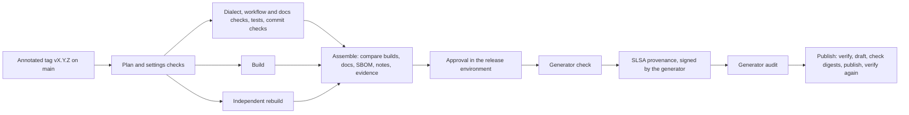

# Making a Release

This page is for the maintainers who publish releases. The release workflow, `.github/workflows/release.yml`, does the work; a maintainer pushes a version tag, and another one approves the release.



On every pull request, and when run by hand, the same workflow rehearses everything up to the approval and publishes nothing. Its summary shows the version the changes call for.

## Before the first release

Each of these settings is a prerequisite. The release run checks the ones it can read, and refuses to publish while they fall short; the others the maintainers confirm, with the commands below the table.

| Setting | Value | Without it | Checked by the run |
| --- | --- | --- | --- |
| Environment `release` | Required reviewers: at least one, a team of two or more recommended. Prevent self-review on. Allow administrators to bypass off. Deployment branches and tags: selected, one tag rule `v*`. | Anyone who can push a tag publishes a release alone. | Yes |
| Ruleset on `main` | Require a pull request with at least one approval, dismiss stale approvals and require approval of the most recent push; require status checks to pass, the release rehearsal and the deploy rehearsal among them (every workflow runs on every pull request, so each of its jobs can be required); block force pushes; restrict deletions; an empty bypass list. | A change to the release workflow, or to the dialect, reaches a release without review. | The rules, their enforcement, and that the run's own token cannot bypass them. GitHub shows a bypass list only to those who can edit the ruleset, so the maintainers confirm that it is empty. |
| Ruleset on every tag (`~ALL`) | Restrict creations, updates and deletions, with the release maintainers as the only bypass. | Any writer starts a release run, and a tag can move after its run. | The rules, their enforcement, and that the run's own token cannot bypass them. |
| Write access | The release maintainers only. | Any writer can create a release outside the workflow on a tag that has none yet. | No. **Verify Releases** reports such a release. |
| Immutable releases | On. | A published release's assets can be replaced. | By the weekly verification. |
| Configuration variables | None, at repository, environment and organisation level. The provenance publishes them. | The provenance publishes their values. | Yes |
| Actions permissions | Default workflow permissions read-only; Actions may not create or approve pull requests; approval required for workflows from all outside contributors' forks. | A job that declares no permissions gets a write token; a fork's workflow change runs without a maintainer's look. | No |
| Allowed actions | Actions created by GitHub, `slsa-framework/slsa-github-generator/.github/workflows/generator_generic_slsa3.yml@v2.1.0` and the generator's own actions at `@v2.1.0` that its jobs use, and nothing else, so the generator's upload action never runs. | A changed workflow can run any action. | No |
| Require actions to be pinned to a full-length commit SHA | Off: the generator's own actions are referenced by tag, and the policy would refuse them. zizmor and the workflow's tests enforce the pinning instead. | Switched on, it stops the generator. | No |
| Private vulnerability reporting | On. | A reporter has no private channel. | No |
| Environment `github-pages` | Deployment branches: `main` only. Allow administrators to bypass off. | A branch other than `main` can publish the site. | No |
| Pages custom domain | `mavlink-m.dronecode.org` verified for the organisation (a DNS TXT record). | Another account can claim the domain for its own Pages site. | No |
| Tag pusher's email | The maintainer who pushes release tags keeps their GitHub email address private (Settings, Emails, "Keep my email addresses private"), so the provenance records a no-reply address. | The provenance publishes the address. | No |

Each can be read with the GitHub CLI. The first six reads need no credentials; the others need a repository administrator's:

```sh
R=Dronecode/mavlink-military
gh api repos/$R/environments/release --jq '{can_admins_bypass, protection_rules}'
gh api repos/$R/environments/release/deployment-branch-policies --jq '.branch_policies'
gh api repos/$R/rules/branches/main
gh api repos/$R/rulesets --jq '.[] | {id, name, target, enforcement}'   # then repos/$R/rulesets/ID
gh api repos/$R/private-vulnerability-reporting                          # {"enabled": true}
gh api repos/$R/environments/github-pages/deployment-branch-policies --jq '.branch_policies'
gh api repos/$R/immutable-releases                                       # "enabled": true
gh variable list -R $R; gh variable list -R $R -e release; gh variable list -o Dronecode
gh api repos/$R/actions/permissions            # "allowed_actions": "selected", "sha_pinning_required": false
gh api repos/$R/actions/permissions/selected-actions
gh api repos/$R/actions/permissions/workflow   # "default_workflow_permissions": "read", "can_approve_pull_request_reviews": false
gh api repos/$R/actions/permissions/fork-pr-contributor-approval   # "approval_policy": "all_external_contributors"
gh api repos/$R/pages --jq '{cname, https_enforced, protected_domain_state}'   # "protected_domain_state": "verified"
gh api --paginate repos/$R/collaborators --jq '.[] | "\(.login) \(.role_name)"'   # write, maintain and admin: the release maintainers only
```

## Rehearse the publication once in a sandbox

No release exists until the first real one, so before it the maintainers run the publication path once in a public, Dronecode-owned scratch repository: a copy of this repository with the settings above and a test tag. The workflow publishes only from `Dronecode/mavlink-military`, so a commit in the scratch repository alone replaces that name, in the job conditions of `release.yml` and as `RELEASE_UPSTREAM`, with the scratch repository's. Record:

- that GitHub accepts the provenance job's permissions;
- that the generator's upload job is skipped and no third-party action runs;
- that the signed subjects equal `SHA256SUMS`;
- the certificate's signer workflow and commit, its `buildConfigURI` and its source ref;
- that every command of [Verifying a Release](verify.md) passes, and fails for a wrong tag;
- what `current_user_can_bypass` the run's token sees on each ruleset;
- whether re-running an approved run asks for the approval again, and which account a re-run reports as its triggering actor;
- that **Verify Releases** passes on the test release, with `DOCS_SITE` naming the scratch repository's site and the deploy job's condition naming the scratch repository;
- that withdrawing the test release works: a pull request lists it in `.github/release-status.json`, **Deploy Docs** then shows its withdrawn banner and serves the root from `main/`, and **Verify Releases** still passes.

## Publish a release

1. Check that `main` is green and that a rehearsal on it names the version you intend; a tag below what the changes call for fails.
2. Tag the commit on `main` with an annotated tag, or a signed one with `git tag -s` if you sign your tags; the release does not require a signature. A `Decision:` line links the public record of the working group's decision, and the notes show it. The tag's message is public as soon as the tag is pushed, before anyone approves the release, so it holds only the version and that link. Push one release tag at a time: GitHub starts no workflow for a push of more than three tags at once.

    ```sh
    git tag -a vX.Y.Z -m "MAVLink-M X.Y.Z" -m "Decision: https://..."
    git push origin vX.Y.Z
    ```

3. The run plans, checks, builds twice and assembles. Read its summary before approving: the commit, the two builds' agreement and checks, every job's result, the vulnerability record, every file's SHA-256 and the release notes. Where an organisation owner can, also read the organisation's audit log for this repository since the previous release (rulesets, environments, Actions settings, deploy keys, collaborators and teams).
4. A reviewer other than the one who pushed the tag approves the run in the `release` environment. A `Decision:` line in the approval's comment links a public record, as the tag's does; the publication record keeps that link and nothing else of the comment. The release files are kept 30 days, as long as GitHub lets an approval wait; after that, re-run the whole workflow.
5. The generator signs the provenance, the audit checks the generator's jobs, and the publish job publishes the release once every file verifies. If the generator's jobs run much longer than their usual few minutes, cancel the run: they hold their tokens until they end, for up to 360 minutes.
6. Run **Deploy Docs** by hand, or let its daily run add the release's pages, and run **Verify Releases**.

If a run fails after the draft was made, re-run it: the draft is deleted and made again. A published release is never changed.

## Keep the release path current

- **Generator.** Dependabot proposes a new generator version in a pull request of its own, and the release checks fail until `GENERATOR_TAG`, `GENERATOR_COMMIT` and `GENERATOR_ACTIONS` in `release.yml` move with the tag. Review the new version's workflow, its actions and its changelog first. Reject a version whose running jobs gain a write permission or whose upload condition changes. Each earlier release keeps its own generator commit in its own `release.yml`.
- **Python tools.** Dependabot proposes updates to the hash-locked files in `.github/requirements`, each pin with the hashes of its new version; to add a package, regenerate the file with the command in its header.
- **Generator pins.** `MAVLINK_REF` and `PYMAVLINK_REF` move by hand, together. The next release's version policy then also compares the included definitions and the fixed C headers.

## Why the generator is referenced by a tag

Every action and workflow in this repository is pinned to a full commit, with one exception: `release.yml` calls the SLSA generator by its version tag, because the generator fails when it is referenced by a commit. That one line is the whole exception. zizmor's pinning policy names that workflow alone, and these controls make the tag as good as the commit it names:

- consumers pin the generator's commit when they verify (`--signer-digest`);
- the release run checks, before the generator runs, that the run loaded the generator at the reviewed commit, that the tag still names it, and, from the generator's job logs, that every action it downloaded is at its reviewed commit and that no job held a write token;
- the generator call runs only after the approval and holds nothing but the call; its `contents: write` is a ceiling GitHub requires because the generator's upload job declares it, and that job does not run;
- the rulesets on `main` and on every tag keep the release workflow and the tags from changing outside review;
- Dependabot and the weekly verification report a new generator version, a moved tag, an archived repository or an advisory.

What it costs: the SLSA project's code is part of the trusted chain; the provenance uses an older format; and OpenSSF Scorecard's Pinned-Dependencies check counts the reference as unpinned, so that check scores lower than it would with every reference pinned. The exception ends when GitHub's workflow dependency lockfile covers called workflows under the commit-pinning policy, when the generator accepts a commit reference, or when the provenance moves to a builder that can be called by commit.

## Monitoring

**Verify Releases** runs every week. It checks every tag against its release, every release's immutability, notes, assets and digests, its provenance online and offline, GitHub's release and asset attestations, its pages on the site and a byte-for-byte rebuild from its tag, and the generator's tag, repository and advisories. A failure fails the run. GitHub stops the schedules of a public repository after 60 days without activity; turn the workflow back on in the Actions tab if that happens.

## Cost

A release run uses about 20 to 30 runner minutes across its jobs, the weekly verification about 3 minutes plus about 2 for each release it rebuilds, and the daily docs deploy about 4. Runners are free for public repositories.
