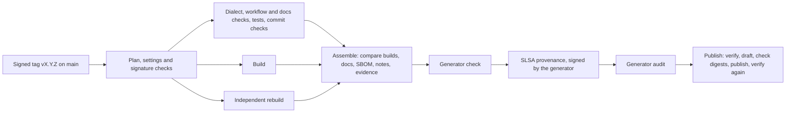

# Making a Release

This page is for the maintainers who publish releases. The release workflow, `.github/workflows/release.yml`, does the work; a maintainer signs a version tag with GPG and pushes it.



On every pull request, and when run by hand, the same workflow rehearses everything up to the signing and publishes nothing. Its summary shows the version the changes call for.

## Who can release

Only the repository's administrators. A ruleset lets only them push a tag, and the run checks that the tag is signed with a GPG key of the account that pushed it, so a release takes an administrator's GitHub account and their private key. Before your first release:

- upload your GPG public key to GitHub (Settings, SSH and GPG keys);
- tag with an email address that is verified on your GitHub account and is one of the key's user IDs, so GitHub shows the tag as **Verified**;
- keep the key unexpired: GitHub stops verifying a signature from an expired key, and the release stops with it.
- keep your GitHub email address private (Settings, Emails) if you do not want it in the provenance, which records the push event.

## Before the first release

The release run checks the settings it can read, and refuses to publish while they fall short; the others the maintainers confirm, with the commands below the table.

| Setting | Value | Without it | Checked by the run |
| --- | --- | --- | --- |
| Ruleset on `main` | Require a pull request with at least one approval; block force pushes and deletions. The repository admin role may bypass. | A change to the release workflow, or to the dialect, reaches a release without review. | The rules, and that the run's own token cannot bypass them. |
| Ruleset on every tag (`~ALL`) | Restrict creations, updates and deletions, with the repository admin role as the only bypass. | Any writer starts a release, and a tag can move after its run. | The rules, and that the run's own token cannot bypass them. |
| Immutable releases | On. | A published release's assets can be replaced. | By the weekly verification. |
| Configuration variables | None, at repository and organisation level. The provenance publishes them. | The provenance publishes their values. | Yes |
| Actions permissions | Default workflow permissions read-only; approval required for workflows from all outside contributors' forks. | A job that declares no permissions gets a write token; a fork's workflow change runs without a maintainer's look. | No |
| Allowed actions | Actions created by GitHub, `slsa-framework/slsa-github-generator/.github/workflows/generator_generic_slsa3.yml@v2.1.0` and the generator's own actions at `@v2.1.0` that its jobs use, and nothing else. | A changed workflow can run any action. | No |
| Require actions to be pinned to a full-length commit SHA | Off: the generator's own actions are referenced by tag, and the policy would refuse them. zizmor and the workflow's tests enforce the pinning instead. | Switched on, it stops the generator. | No |
| Environment `github-pages` | Deployment branches: `main` only. | A branch other than `main` can publish the site. | No |

Each can be read with the GitHub CLI; the last four need a repository administrator's credentials:

```sh
R=Dronecode/mavlink-military
gh api repos/$R/rules/branches/main
gh api repos/$R/rulesets --jq '.[] | {id, name, target, enforcement}'   # then repos/$R/rulesets/ID
gh api repos/$R/immutable-releases                                       # "enabled": true
gh variable list -R $R; gh variable list -o Dronecode
gh api repos/$R/actions/permissions            # "allowed_actions": "selected", "sha_pinning_required": false
gh api repos/$R/actions/permissions/selected-actions
gh api repos/$R/actions/permissions/workflow   # "default_workflow_permissions": "read"
gh api repos/$R/environments/github-pages/deployment-branch-policies --jq '.branch_policies'
```

## Publish a release

1. Check that `main` is green and that a rehearsal on it names the version you intend; a tag below what the changes call for fails. Read the rehearsal's summary: the builds' agreement and checks, the vulnerability record and the release notes.
2. Sign the tag on `main` and push it. A `Decision:` line can link the public record of the working group's decision, and the notes show it. The tag's message is public as soon as it is pushed. Push one release tag at a time: GitHub starts no workflow for a push of more than three tags at once.

    ```sh
    git tag -s vX.Y.Z -m "MAVLink-M X.Y.Z" -m "Decision: https://..."
    git push origin vX.Y.Z
    ```

3. The run checks the tag's signature, plans, checks, builds twice, assembles, signs the provenance and publishes the release once every file verifies. If the generator's jobs run much longer than their usual few minutes, cancel the run: they hold their tokens until they end, for up to 360 minutes.
4. Run **Deploy Docs** by hand, or let its daily run add the release's pages, and run **Verify Releases**.

If a run fails after the draft was made, re-run it: the draft is deleted and made again. A published release is never changed.

## Keep the release path current

- **Generator.** Dependabot proposes a new generator version in a pull request of its own, and the release checks fail until `GENERATOR_TAG`, `GENERATOR_COMMIT` and `GENERATOR_ACTIONS` in `release.yml` move with the tag. Review the new version's workflow, its actions and its changelog first. Reject a version whose running jobs gain a write permission or whose upload condition changes. Each earlier release keeps its own generator commit in its own `release.yml`.
- **Python tools.** Dependabot proposes updates to the hash-locked files in `.github/requirements`, each pin with the hashes of its new version; to add a package, regenerate the file with the command in its header.
- **Generator pins.** `MAVLINK_REF` and `PYMAVLINK_REF` move by hand, together. The next release's version policy then also compares the included definitions and the fixed C headers.

## Why the generator is referenced by a tag

Every action and workflow in this repository is pinned to a full commit, with one exception: `release.yml` calls the SLSA generator by its version tag, because the generator fails when it is referenced by a commit. That one line is the whole exception. zizmor's pinning policy names that workflow alone, and these controls make the tag as good as the commit it names:

- consumers pin the generator's commit when they verify (`--signer-digest`);
- the release run checks, before the generator runs, that the run loaded the generator at the reviewed commit, that the tag still names it, and, from the generator's job logs, that every action it downloaded is at its reviewed commit and that no job held a write token;
- the generator call runs only after every check and both builds agree, and holds nothing but the call; its `contents: write` is a ceiling GitHub requires because the generator's upload job declares it, and that job does not run;
- the rulesets on `main` and on every tag keep the release workflow and the tags from changing outside review;
- Dependabot and the weekly verification report a new generator version, a moved tag, an archived repository or an advisory.

What it costs: the SLSA project's code is part of the trusted chain; the provenance uses an older format; and OpenSSF Scorecard's Pinned-Dependencies check counts the reference as unpinned, so that check scores lower than it would with every reference pinned. The exception ends when GitHub's workflow dependency lockfile covers called workflows under the commit-pinning policy, when the generator accepts a commit reference, or when the provenance moves to a builder that can be called by commit.

## Monitoring

**Verify Releases** runs every week. It checks every tag against its release, every release's immutability, notes, assets and digests, its provenance online and offline, GitHub's release and asset attestations, its pages on the site and a byte-for-byte rebuild from its tag, and the generator's tag, repository and advisories. A failure fails the run. GitHub stops the schedules of a public repository after 60 days without activity; turn the workflow back on in the Actions tab if that happens.

## Cost

A release run uses about 20 to 30 runner minutes across its jobs, the weekly verification about 3 minutes plus about 2 for each release it rebuilds, and the daily docs deploy about 4. Runners are free for public repositories.
